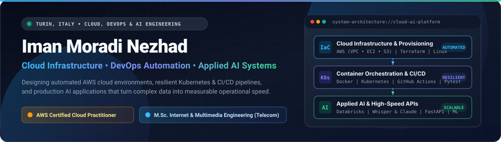

  

 

**Cloud, DevOps & AI Engineer** based in **Turin, Italy** — combining an **M.Sc. in Internet & Multimedia Engineering (Telecommunications)** and **AWS Cloud Practitioner Certification** with hands-on experience building automated cloud infrastructure, containerized microservices, and production AI workflows.

---

## 🎯 Engineering Focus & Value Delivery

| ☁️ Cloud & Infrastructure as Code | ⚙️ DevOps, Containers & CI/CD | 🤖 Applied AI & Backend Systems |
| :--- | :--- | :--- |
| Designing repeatable, secure cloud environments on **AWS** (`VPC`, `EC2`, `S3`, `IAM`) provisioned automatically through **Terraform** with encrypted remote state management. | Packaging full-stack applications with **Docker**, orchestrating workloads on **Kubernetes (CKA track)**, and automating testing and delivery via **GitHub Actions CI/CD**. | Building production-ready **FastAPI** backends, relational data pipelines, and enterprise **LLM / Speech-to-Text AI assistants** (`Whisper`, `Claude`, `Databricks`, `Scikit-Learn`). |

---

## 🚀 Featured Engineering Case Studies

<table>
  <tr>
    <td width="50%" valign="top">
      <h3>🏭 <a href="https://github.com/ImanMrd/Voice-based-AI-application">Industrial AI Voice Assistant</a></h3>
      

        
        
        
        
      

      <ul>
        <li><b>Business Challenge:</b> Factory floor electricians spent ~5 minutes per vehicle defect manually removing gear and typing entries into SharePoint forms.</li>
        <li><b>Architecture:</b> Push-to-talk Python interface connected to enterprise <b>Databricks</b> endpoints running <b>Whisper Large v3</b> (Italian industrial speech-to-text) and <b>Claude 3 Haiku</b> (structured JSON extraction), synced via <b>Power Automate</b> webhooks.</li>
        <li><b>Impact:</b> Cut defect reporting time by <b>80% (~5 min → ~1 min)</b> while improving data standardization across factory operations.</li>
      </ul>
      
<a href="https://github.com/ImanMrd/Voice-based-AI-application"><b>→ View System Architecture &amp; Case Study</b></a>

    </td>
    <td width="50%" valign="top">
      <h3>🇮🇹 <a href="https://github.com/ImanMrd/Daily-Italy">Daily-Italy — Cloud-Native Learning Platform</a></h3>
      

        
        
        
        
      

      <ul>
        <li><b>Problem:</b> Language learners lack a unified platform combining structured CEFR progression, active recall algorithms, and multimodal practice.</li>
        <li><b>Architecture:</b> Asynchronous <b>FastAPI + SQLAlchemy</b> backend, Single-Page Application (SPA) frontend, <b>SuperMemo-2 (SM-2)</b> spaced repetition engine, JWT + <b>RBAC</b> admin panel, multi-stage <b>Dockerfile</b>, and <b>Kubernetes (`k8s/`)</b> manifests.</li>
        <li><b>Impact:</b> 60-chapter CEFR curriculum (A1–B2) backed by an automated <b>GitHub Actions CI/CD</b> pipeline and a 100% passing <code>pytest</code> suite.</li>
      </ul>
      
<a href="https://github.com/ImanMrd/Daily-Italy"><b>→ View Source Code, CI/CD &amp; K8s Manifests</b></a>

    </td>
  </tr>
  <tr>
    <td width="50%" valign="top">
      <h3>🏗️ <a href="https://github.com/ImanMrd/Learning-Terraform">AWS Infrastructure as Code (Terraform)</a></h3>
      

        
        
        
        
      

      <ul>
        <li><b>Challenge:</b> Manual cloud provisioning via web consoles is slow, unrepeatable, and vulnerable to configuration drift.</li>
        <li><b>Architecture:</b> Modular <b>Terraform (HCL)</b> blueprints provisioning custom <b>AWS VPC (`10.0.0.0/16`)</b> networking, <b>EC2 (`t2.micro`)</b> compute instances, and an encrypted <b>S3 Remote Backend (`encrypt = true`)</b> with state locking.</li>
        <li><b>Impact:</b> Replaces manual multi-step server setup with a deterministic, version-controlled <code>terraform apply</code> workflow.</li>
      </ul>
      
<a href="https://github.com/ImanMrd/Learning-Terraform"><b>→ View Terraform Blueprints &amp; Architecture</b></a>

    </td>
    <td width="50%" valign="top">
      <h3>🏥 <a href="https://github.com/ImanMrd/Lung-Cancer-classifier">Clinical Risk Prediction Neural Network</a></h3>
      

        
        
        
        
      

      <ul>
        <li><b>Challenge:</b> High-dimensional clinical datasets often contain missing values and noise, slowing down early diagnostic risk screening.</li>
        <li><b>Architecture:</b> End-to-end ML pipeline performing automated imputation, <b>Principal Component Analysis (PCA, K=50)</b> dimensionality reduction, and classification via a two-layer <b>MLP Neural Network (`50 × 25`, Adam solver, early stopping)</b>.</li>
        <li><b>Impact:</b> Achieved <b>0.0185 Test MSE</b> with automated generation of confusion matrices and loss convergence diagnostics.</li>
      </ul>
      
<a href="https://github.com/ImanMrd/Lung-Cancer-classifier"><b>→ View ML Pipeline &amp; Evaluation Plots</b></a>

    </td>
  </tr>
  <tr>
    <td width="50%" valign="top">
      <h3>⚽ <a href="https://github.com/ImanMrd/Football-Data-Management-API-FastAPI">Sports Data Management REST API</a></h3>
      

        
        
        
        
      

      <ul>
        <li><b>Challenge:</b> Sports platforms need fast, schema-validated endpoints that allow public data reads while strictly protecting administrative writes.</li>
        <li><b>Architecture:</b> RESTful microservice built with <b>FastAPI</b> and <b>SQLModel (SQLite ORM)</b> across 4 relational entities (<code>Team</code>, <code>Player</code>, <code>PlayerRole</code>, <code>PlayerHistory</code>), secured by <b>OAuth2 Bearer JWT (`HS256`)</b> and <code>bcrypt</code> password hashing.</li>
        <li><b>Impact:</b> Enforces strict Role-Based Access Control (<code>require_admin</code>) with auto-generated OpenAPI/Swagger documentation.</li>
      </ul>
      
<a href="https://github.com/ImanMrd/Football-Data-Management-API-FastAPI"><b>→ View API Schema &amp; Auth Flow</b></a>

    </td>
    <td width="50%" valign="top">
      <h3>☸️ <a href="https://github.com/ImanMrd/CKA-2026">Kubernetes (CKA) Lab &amp; Architecture Notes</a></h3>
      

        
        
        
      

      <ul>
        <li><b>Focus:</b> Hands-on preparation and cluster administration labs aligned with the <b>Certified Kubernetes Administrator (CKA)</b> curriculum.</li>
        <li><b>Coverage:</b> Control plane architecture, Pod scheduling, RBAC, Services &amp; Ingress networking, Persistent Volumes, and cluster troubleshooting scenarios.</li>
      </ul>
      
<a href="https://github.com/ImanMrd/CKA-2026"><b>→ Explore Kubernetes Labs &amp; Notes</b></a>

    </td>
  </tr>
</table>

---

## 🛠️ Technical Stack & Tooling

| Domain | Technologies & Tools |
| :--- | :--- |
| **Cloud & Infrastructure** |     |
| **DevOps & Containers** |      |
| **AI & Data Engineering** |       |
| **Backend & Application** |      |

---

## 📫 Let's Connect

- 💼 **LinkedIn:** [linkedin.com/in/iman-moradi-nezhad-722a912b0](https://www.linkedin.com/in/iman-moradi-nezhad-722a912b0)
- 📍 **Location:** Turin, Piedmont, Italy (Open to Cloud, DevOps & AI Engineering opportunities)

<!-- Profile Owner: Iman Moradi Nezhad | Review Triggers: New project launch, certification milestone, or role update | Last Reviewed: 2026-10 -->
